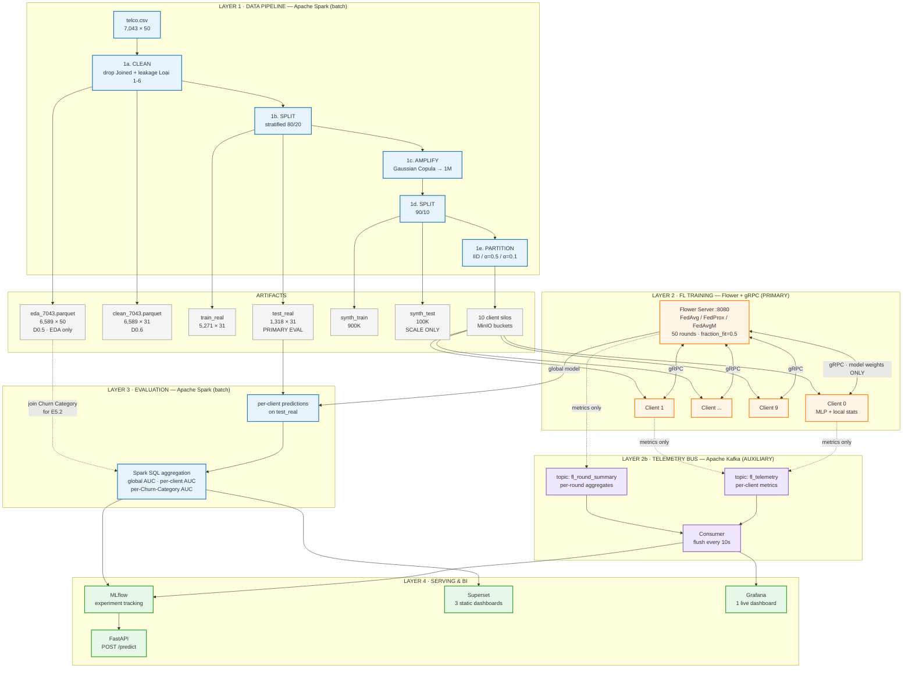
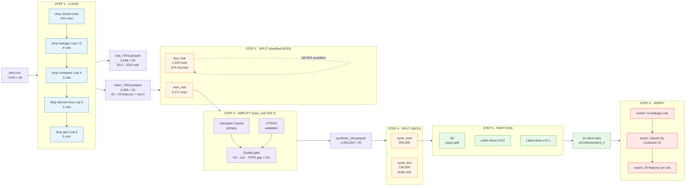
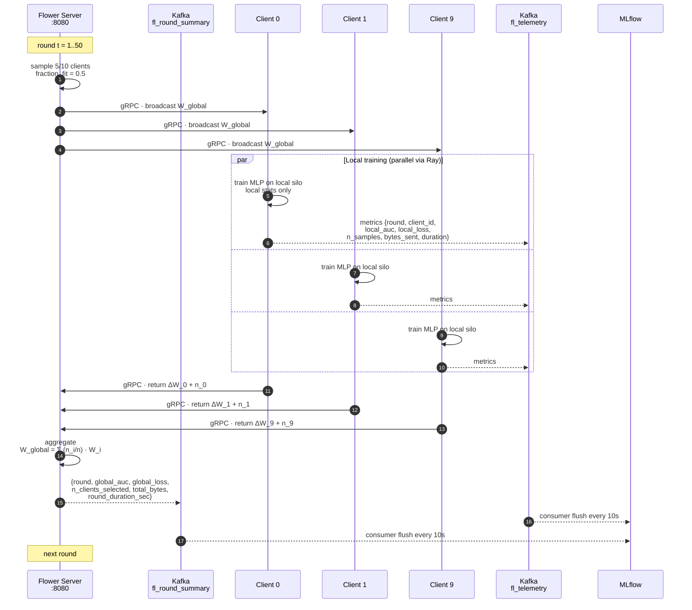
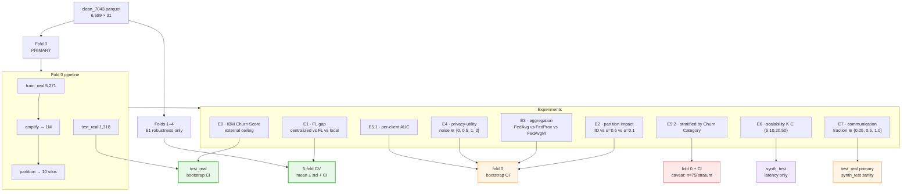
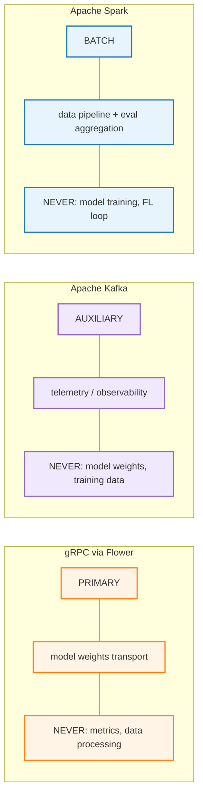
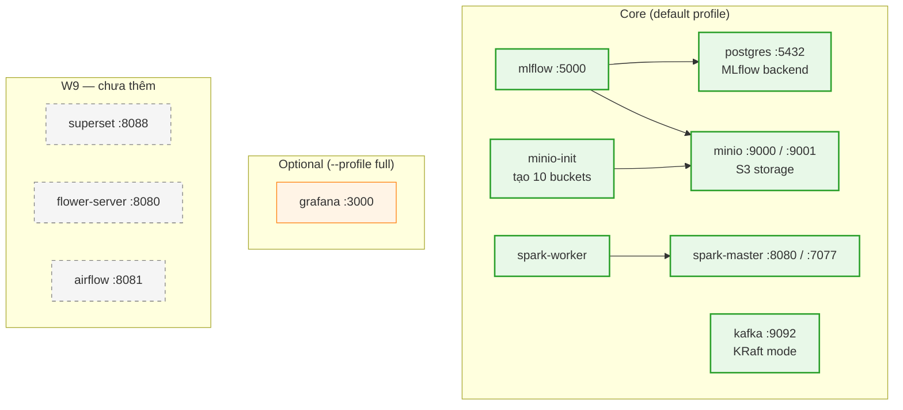

# 12 — Architecture & Data Flow

**Owner:** All · **Tuần:** W1 (cập nhật liên tục) · **Trạng thái:** ✅
**Nguồn quyết định:** Project Decision Record (2026-11-18) + Patch v1 + Patch v2

> Tài liệu này là **bản đồ trực quan** của toàn bộ hệ thống. Mọi con số ở đây
> đã được đo trên dữ liệu thật (`notebooks/01_eda.ipynb`), không phải giả định.

---

## 0. Số liệu nền (authoritative)

| Metric | Value | Nguồn |
|---|---|---|
| Raw shape | 7,043 × 50 | `telco.csv` |
| `Joined` rows dropped | **454 (6.45%)** | EDA §3.1 |
| Cohort sau CLEAN | **6,589** | EDA §3.2 |
| Churn rate | **28.37%** | EDA §3.2 |
| Churned / Stayed | **1,869 / 4,720** | EDA §3.2 |
| Features | **29** | `src/data/clean.py` |
| `clean_7043.parquet` | **6,589 × 31** | D0.6 |
| `eda_7043.parquet` | **6,589 × 50** | D0.5 |
| E0 — IBM Churn Score AUC | **0.9421** | EDA §3.5 |
| `test_real` | **1,318 rows / 374 churned** | 20% stratified split |
| `train_real` | **5,271 rows** | 80% stratified split |

---

## 1. Kiến trúc tổng thể (4 layers)

---

## 2. Data pipeline — CLEAN → SPLIT → AMPLIFY → SPLIT → PARTITION

Thứ tự này là **bắt buộc**. Amplify trước khi split sẽ khiến Copula học cả phân phối
của test set → đánh giá trở thành circular, không đo được generalization.

### 2.1 Bảng artifact

| Artifact | Shape | Vai trò | Được amplify? | Được partition? |
|---|---|---|---|---|
| `eda_7043.parquet` (D0.5) | 6,589 × 50 | EDA, E0, E5.2 strata | ❌ | ❌ |
| `clean_7043.parquet` (D0.6) | 6,589 × 31 | Nguồn cho split | ❌ | ❌ |
| `train_real` | 5,271 × 31 | Nguồn amplify | ✅ | ❌ |
| `test_real` | 1,318 × 31 | **Primary eval** | ❌ | ❌ |
| `synthetic_1M` (D1) | 1,000,000 × 30 | Nguồn partition | — | ❌ |
| `synth_train` | 900,000 × 30 | Nguồn partition | — | ✅ |
| `synth_test` | 100,000 × 30 | Scale eval only | — | ❌ |
| 10 client silos | ~90,000 × 30 mỗi silo | FL training | — | — |

---

## 3. FL round — sequence diagram

---

## 4. Experiment protocol — tiered evaluation

Quyết định: **E1 dùng 5-fold CV**, **E2–E7 dùng fold 0 + bootstrap CI**.
Lý do: 5-fold cho toàn bộ sẽ cần ~45 FL runs (2–4 giờ) và làm strata của E5.2
co lại còn ~75 churned/stratum.

### 4.1 Bảng protocol

| Experiment | Test set | Protocol | Reporting |
|---|---|---|---|
| E0 | `test_real` | 1 lần | AUC + bootstrap 95% CI |
| **E1** | `test_real` | **5-fold CV** | **mean ± std + bootstrap CI** |
| E2 | `test_real` | fold 0 | AUC + bootstrap CI |
| E3 | `test_real` | fold 0 | AUC + per-client std + CI |
| E4 | `test_real` | fold 0 | AUC vs ε curve + CI |
| E5.1 | `test_real` | fold 0 | per-client AUC distribution + CI |
| E5.2 | `test_real` + `eda_7043` | fold 0 | per-stratum AUC + CI + caveat |
| E6 | `synth_test` | fold 0 | latency, AUC consistency |
| E7 | `test_real` (primary) + `synth_test` (sanity) | fold 0 | bytes, AUC |

### 4.2 Diagnostic bắt buộc

Nếu `|AUC_synth_test − AUC_test_real| > 10%` → **synthetic data quality problem**.
Báo cáo như một finding, không được ẩn.

---

## 5. Non-overlap principle

Ba công cụ **không bao giờ** chồng chéo trách nhiệm.

| Tool | Role | Never does |
|---|---|---|
| **gRPC (Flower)** | Model weights transport | Metrics, data processing |
| **Kafka** | Observability / telemetry bus | Model weights, training data |
| **Spark** | Batch data processing + eval aggregation | Model training, FL loop |

---

## 6. Docker Compose services

**Resource:** default ~8 GB RAM · `--profile full` ~12 GB RAM.

---

## 7. Đọc tiếp

| Cần hiểu | Đọc |
|---|---|
| Quyết định dữ liệu (leakage, 29 features) | `04_data_decisions.md` |
| Chi tiết Spark pipeline | `05_spark_pipeline.md` |
| Chi tiết Kafka telemetry | `08_kafka_telemetry.md` |
| Scope, hypothesis, RACI | `01_kickoff_notes.md` |
