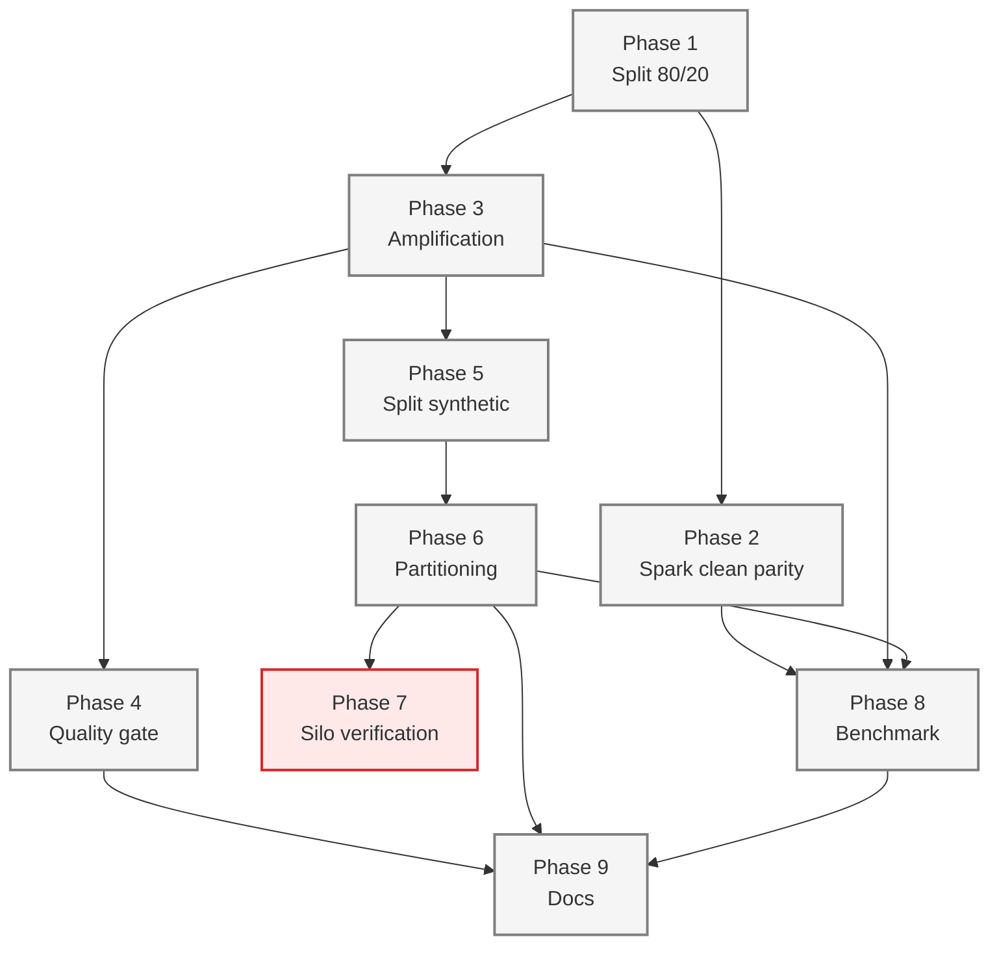

# 13 — Layer 1 Completion Plan (Data Pipeline)

**Owner:** Person A (lead) · **Tuần:** W2–W3 · **Trạng thái:** 🚧 Đang thực hiện
**Tham chiếu:** `12_architecture.md` §2 · `05_spark_pipeline.md` · `04_data_decisions.md`

---

## 0. Mục tiêu

Hoàn thành **Layer 1 — DATA PIPELINE** để sinh toàn bộ artifact mà Layer 2 (FL training)
cần. Layer 1 kết thúc khi:

- 10 client silo tồn tại trên MinIO, mỗi silo có đúng 29 features + target
- `test_real` tồn tại và **chưa từng** bị amplify hay partition
- Quality gate của synthetic data pass (KS, correlation, TSTR gap < 5%)
- Benchmark 1M rows < 15 phút trên `local[*]`

---

## 1. Hiện trạng (đã có)

| Hạng mục | Trạng thái | Ghi chú |
|---|---|---|
| `src/data/clean.py` (pandas) | ✅ | 29 features, 20 dropped, 8 assertions |
| `data/processed/eda_7043.parquet` (D0.5) | ✅ | 6,589 × 50 |
| `data/processed/clean_7043.parquet` (D0.6) | ✅ | 6,589 × 31 |
| `configs/base.yaml` | ✅ | `data`, `amplification`, `partitioning`, `spark`, `kafka` |
| `docker-compose.yml` | ✅ | minio, spark-master, spark-worker, kafka, mlflow, postgres |
| `tests/test_01_clean.py` | ✅ | 29 tests pass |
| `docs/12_architecture.md` | ✅ | 6 sơ đồ Mermaid |

## 2. Còn thiếu (13 items)

| # | Hạng mục | File | Phase |
|---|---|---|---|
| 1 | Stratified split 80/20 | `src/data/split.py` | P1 |
| 2 | Spark clean (parity) | `src/data/spark_clean.py` | P2 |
| 3 | Amplification Copula + CTGAN | `src/data/amplify.py` | P3 |
| 4 | Spark amplify (parallel) | `src/data/spark_amplify.py` | P3 |
| 5 | Quality gate | `src/data/quality_gate.py` | P4 |
| 6 | Partitioning IID + Dirichlet | `src/partitioning/partitioner.py` | P6 |
| 7 | Spark partitioner → MinIO | `src/partitioning/spark_partition.py` | P6 |
| 8 | Silo verification | `src/partitioning/verify_silos.py` | P7 |
| 9 | Config block `split:` | `configs/base.yaml` | P1 |
| 10 | Tests split + partition | `tests/test_02_split.py`, `tests/test_05_partition.py` | P1, P6 |
| 11 | Benchmark | `scripts/03_benchmark_spark.py` | P8 |
| 12 | Docs synthetic | `docs/06_synthetic_decision.md` | P4 |
| 13 | Docs partition | `docs/07_partition_design.md` | P6 |

---

## 3. Artifacts sẽ sinh ra

| Artifact | Shape | Amplify? | Partition? | Deliverable |
|---|---|---|---|---|
| `data/processed/eda_7043.parquet` | 6,589 × 50 | ❌ | ❌ | **D0.5** ✅ |
| `data/processed/clean_7043.parquet` | 6,589 × 31 | ❌ | ❌ | **D0.6** ✅ |
| `data/processed/train_real.parquet` | **5,271 × 31** | ✅ | ❌ | 🆕 |
| `data/processed/test_real.parquet` | **1,318 × 31** | ❌ | ❌ | 🆕 **PRIMARY EVAL** |
| `data/synthetic/synthetic_1m.parquet` | **1,000,000 × 30** | — | ❌ | **D1** 🆕 |
| `data/synthetic/synth_train.parquet` | **900,000 × 30** | — | ✅ | 🆕 |
| `data/synthetic/synth_test.parquet` | **100,000 × 30** | — | ❌ | 🆕 scale only |
| `data/synthetic/quality_report.json` | — | — | — | **D1** 🆕 |
| `data/synthetic/ctgan_1m.parquet` | 1,000,000 × 30 | — | ❌ | 🆕 validation |
| `s3://clients/client_{0..9}/features.parquet` | ~90,000 × 30 | — | — | **D2** 🆕 |
| `results/partition_metadata.json` | — | — | — | **D2** 🆕 |
| `results/spark_benchmark.csv` | — | — | — | 🆕 |

### 3.1 Bất biến từng artifact

**`train_real` / `test_real`**
```
Nguồn   : clean_7043.parquet (6,589 × 31)
Phương  : train_test_split(stratify=churn, test_size=0.2, random_state=42)
Kỳ vọng : train 5,271 (churned 1,495) | test 1,318 (churned 374)
Bất biến: disjoint ID · churn rate ±1% · test_real KHÔNG BAO GIỜ amplify/partition
```

**`synthetic_1m`**
```
Nguồn   : train_real.parquet (5,271 × 31)
Phương  : Gaussian Copula fit trên train_real
Kỳ vọng : 1,000,000 × 30 (29 features + churn, KHÔNG có Customer ID)
Bất biến: không leakage · churn rate 28.37% ± 1% · KS pass ≥ 90% cột
```

**10 client silos**
```
Nguồn   : synth_train.parquet (900,000 × 30)
Phương  : IID | Dirichlet α=0.5 | Dirichlet α=0.1
Kỳ vọng : 10 silo × ~90,000 rows
Bất biến: 29 features + churn · không leakage · disjoint · tổng = 900,000
```

---

## 4. Phases

### Phase 1 — Split (W2, ngày 1) · *không phụ thuộc*

| Bước | Việc |
|---|---|
| 1.1 | Thêm block `split:` vào `configs/base.yaml` |
| 1.2 | `split_real(df, test_size, seed)` → `(train, test)` |
| 1.3 | Assertions: disjoint ID, stratified ±1%, shape đúng |
| 1.4 | CLI `python -m src.data.s02_split` ghi 2 parquet |
| 1.5 | `tests/test_02_split.py` |

**Config mới:**
```yaml
split:
  test_size: 0.2
  seed: 42
  stratify_on: churn
  n_folds: 5
```

**Verification:** 5,271 / 1,318 rows · `set(train.ID) & set(test.ID) == ∅` · `|Δchurn_rate| < 0.01`

**Commit:** `feat(data): stratified 80/20 split producing train_real and test_real`

---

### Phase 2 — Spark clean parity (W2, ngày 2) · *depends on P1*

| Bước | Việc |
|---|---|
| 2.1 | `SparkSession` builder đọc config |
| 2.2 | Explicit schema 50 cột (không `inferSchema`) |
| 2.3 | Rename header lỗi `"Total Refu    nds"` |
| 2.4 | Filter `Joined`, drop 4 nhóm, derive `churn` |
| 2.5 | Assertion parity: shape, columns, churn rate == pandas |
| 2.6 | Ghi `clean_7043_spark.parquet` để so sánh |

**Bẫy:** `"None"` là category hợp lệ → **không** set `nullValue="None"`. Header lỗi phải rename **trước** khi drop.

**Verification:** `count() == 6589` · `set(cols) == set(pandas_cols)` · `|Δchurn_rate| < 1e-9`

**Commit:** `feat(data): Spark clean with parity assertions against pandas reference`

---

### Phase 3 — Amplification (W2, ngày 3–4) · *depends on P1*

| Bước | Việc |
|---|---|
| 3.1 | `fit_copula(train_real)` → model |
| 3.2 | `sample_copula(model, n=1_000_000)` |
| 3.3 | `fit_ctgan(train_real)` + sample (validation) |
| 3.4 | Post-process: clip numeric về range gốc, round categorical |
| 3.5 | Ghi `synthetic_1m.parquet` + `ctgan_1m.parquet` |
| 3.6 | Spark parallel version (SDV fit pandas, Spark apply) |

**Verification:** 1,000,000 × 30 · không NaN · churn 28.37% ± 1% · numeric trong range gốc

**Commit:** `feat(data): Gaussian Copula amplification from train_real (1M rows)`

---

### Phase 4 — Quality gate (W2, ngày 5) · *depends on P3*

| Bước | Việc |
|---|---|
| 4.1 | KS test từng cột (α = 0.05) |
| 4.2 | Correlation matrix diff (Frobenius) |
| 4.3 | **TSTR**: train synthetic → test `test_real` → AUC gap |
| 4.4 | So sánh Copula vs CTGAN |
| 4.5 | Ghi `quality_report.json` |
| 4.6 | Viết `docs/06_synthetic_decision.md` |

**Ngưỡng pass:**

| Metric | Ngưỡng |
|---|---|
| KS pass rate | ≥ 90% số cột |
| Correlation Frobenius diff | < 0.15 |
| TSTR AUC gap | < 5% |

**Nếu fail:** ghi như finding, fallback 7K gốc + K=5.

**Commit:** `feat(data): synthetic quality gate (KS, correlation, TSTR)`

---

### Phase 5 — Split synthetic (W2, ngày 5) · *depends on P3*

| Bước | Việc |
|---|---|
| 5.1 | `split_synthetic(df, test_size=0.1)` |
| 5.2 | Ghi `synth_train.parquet` (900K) + `synth_test.parquet` (100K) |

---

### Phase 6 — Partitioning (W3, ngày 1–2) · *depends on P5*

| Bước | Việc |
|---|---|
| 6.1 | `assign_iid(df, K)` — shuffle + equal split |
| 6.2 | `assign_dirichlet(df, K, alpha)` |
| 6.3 | Sinh synthetic `Customer ID` (SYN-0000001…) |
| 6.4 | Ghi metadata: churn ratio + size per client |
| 6.5 | Spark version ghi thẳng MinIO |
| 6.6 | `tests/test_05_partition.py` |

**Verification:**
- IID: ~90,000 rows/client, churn 28.37% ± 0.5%
- α=0.5: dao động vừa phải
- α=0.1: có client gần như toàn 0 hoặc toàn 1
- Tổng = 900,000 · disjoint ID

**Commit:** `feat(partition): IID and Dirichlet partitioning with metadata`

---

### Phase 7 — Silo verification (W3, ngày 3) · *depends on P6* ⚠️ **GATE**

| Bước | Việc |
|---|---|
| 7.1 | Đọc 10 silo từ MinIO |
| 7.2 | Assert: không cột leakage |
| 7.3 | Assert: 29 features mỗi silo |
| 7.4 | Assert: disjoint ID |
| 7.5 | Assert: tổng rows = 900,000 |
| 7.6 | Ghi `results/silo_verification.json` |

**Đây là gate cuối Layer 1.** Fail → không được bắt đầu Layer 2.

**Commit:** `feat(partition): silo verification gate (leakage, disjointness, feature count)`

---

### Phase 8 — Benchmark (W3, ngày 4) · *depends on P2, P3, P6*

| Bước | Việc |
|---|---|
| 8.1 | Đo clean/amplify/partition ở 10K, 100K, 1M |
| 8.2 | Ghi `results/spark_benchmark.csv` |
| 8.3 | Bảng vào `docs/05_spark_pipeline.md` §3 |

**Ngưỡng:** 1M end-to-end < 15 phút (success criterion #9).

**Commit:** `feat(bench): Spark pipeline benchmark 10K/100K/1M`

---

### Phase 9 — Docs (song song)

| Doc | Khi nào |
|---|---|
| `docs/06_synthetic_decision.md` | sau P4 |
| `docs/07_partition_design.md` | sau P6 |
| `docs/05_spark_pipeline.md` §3 | sau P8 |
| `docs/00_index.md` | sau mỗi doc |

---

## 5. Dependency graph



**Critical path:** P1 → P3 → P5 → P6 → P7
**Parallel:** P2 chạy song song P3

---

## 6. Commit plan

| # | Message | Sau phase |
|---|---|---|
| 1 | `docs: add Layer 1 completion plan` | — |
| 2 | `feat(data): stratified 80/20 split → train_real / test_real` | P1 |
| 3 | `feat(data): Spark clean with parity assertions` | P2 |
| 4 | `feat(data): Gaussian Copula amplification (1M rows)` | P3 |
| 5 | `feat(data): synthetic quality gate + decision doc` | P4 |
| 6 | `feat(partition): IID + Dirichlet partitioning` | P6 |
| 7 | `feat(partition): silo verification gate` | P7 |
| 8 | `feat(bench): Spark benchmark 10K/100K/1M` | P8 |

**Quy ước:** Conventional Commits · mỗi commit pass `pytest` · không commit data/artifact.

---

## 7. Definition of Done

| # | Check | Lệnh |
|---|---|---|
| 1 | `train_real` + `test_real` disjoint | `pytest tests/test_02_split.py -v` |
| 2 | Spark clean khớp pandas | `python -m src.data.s01_clean_spark --verify` |
| 3 | `synthetic_1m` = 1,000,000 × 30 | `python -m src.data.s03_amplify --check` |
| 4 | Quality gate pass | `python -m src.data.s04_quality_gate` |
| 5 | `synth_train` 900K + `synth_test` 100K | `pytest tests/test_02_split.py -v` |
| 6 | 10 silo trên MinIO | `python -m src.partitioning.s06_verify_silos` |
| 7 | Không silo nào chứa leakage | `verify_silos` assertion |
| 8 | Tổng rows silo = 900,000 | `verify_silos` assertion |
| 9 | Benchmark 1M < 15 phút | `results/spark_benchmark.csv` |
| 10 | `pytest tests/ -q` pass | — |
| 11 | Docs 06, 07 hoàn thành | — |
| 12 | `00_index.md` cập nhật | — |

---

## 8. Rủi ro & fallback

| Risk | Xác suất | Fallback |
|---|---|---|
| Copula kém (KS fail > 10% cột) | Trung bình | CTGAN primary → 7K gốc, K=5 |
| Spark chậm > 15 phút | Trung bình | Giảm `shuffle_partitions`, tăng `driver.memory`; hoặc pandas cho clean/amplify |
| MinIO write chậm | Thấp | Ghi local trước, sync sau |
| Dirichlet α=0.1 sinh client rỗng | Thấp | Clamp min 100 samples/client |
| **`test_real` lọt vào amplify** | **Cao nếu bất cẩn** | Assertion: `test_real` không có trong bất kỳ silo nào |

---

## 9. Bàn giao cho Layer 2

| Cho | Artifact |
|---|---|
| FL client | 10 silo `s3://clients/client_{i}/features.parquet` |
| Evaluation | `test_real.parquet` (primary), `synth_test.parquet` (scale) |
| E5.2 | `eda_7043.parquet` (join `Churn Category` trên `Customer ID`) |
| E0 | `e0_auc = 0.9421` |
| MLflow | `results/partition_metadata.json` để log tags |
