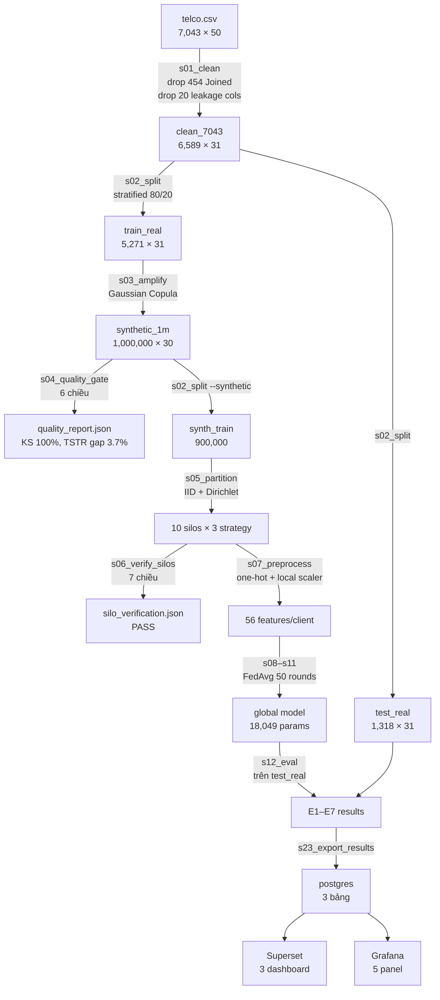
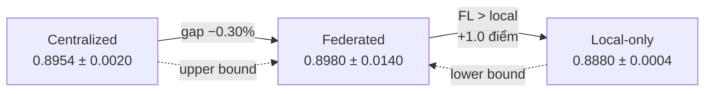
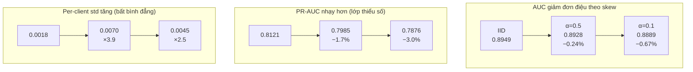
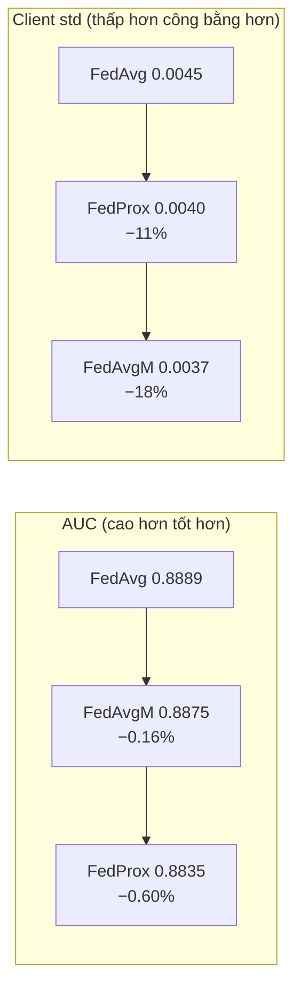
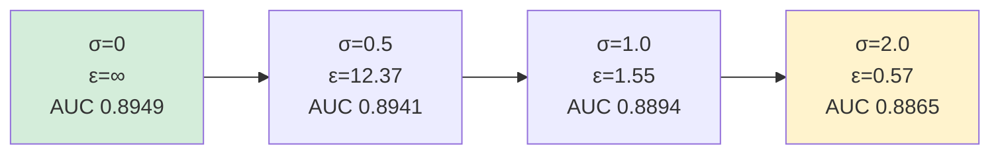
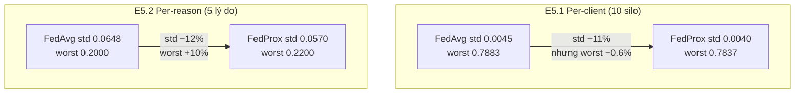
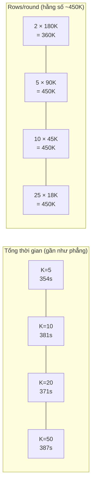
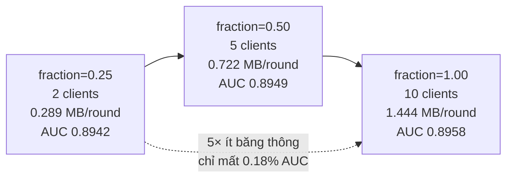
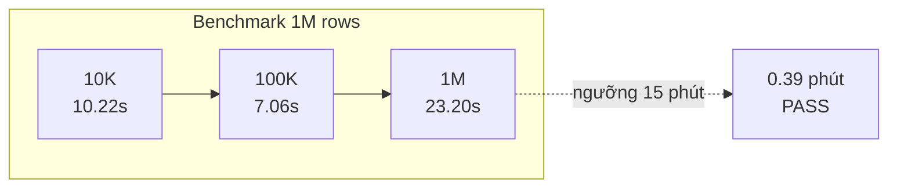

# 20 — Tổng hợp số liệu và so sánh

> **Mục đích:** mọi con số của project ở một chỗ, kèm so sánh giữa các cách làm.
> Mỗi số đều trỏ về file JSON sinh ra nó, nên kiểm chứng được.
>
> **Nguyên tắc:** không có số nào trong tài liệu này mà không đọc được từ
> `results/*.json`. Nếu lệch, file JSON là nguồn đúng.

---

## 1. Luồng dữ liệu và nơi số liệu phát sinh

**Điểm cần nhớ:** mọi metric cuối cùng đều tính trên `test_real` (1,318 dòng
**thật**), không phải trên synthetic. Synthetic chỉ dùng để train.

---

## 2. Số liệu từng stage

### 2.1 Stage 1 — Làm sạch

| Chỉ số | Giá trị | Nguồn |
|---|---|---|
| Raw rows × cols | 7,043 × 50 | `telco.csv` |
| Rows bị drop (`Customer Status = Joined`) | 454 (6.45%) | `results/eda_summary.csv` |
| Cohort sau drop | 6,589 | `clean_7043.parquet` |
| Churn rate | **28.37%** (1,869 / 4,720) | `clean_7043.parquet` |
| Features giữ lại | 29 (5 demo + 6 account + 12 services + 6 usage) | `src/data/s01_clean.py` |
| Cột bị drop | 20 (2 target + 3 post-hoc + 4 indirect + 3 constant + 5 geo + 3 duplicate) | `results/eda_leakage_audit.csv` |

**Hai cạm bẫy dữ liệu đã xử lý:**

1. Header lỗi `"Total Refu    nds"` (4 space chèn giữa) — nếu không sửa, cột
   này lọt vào feature matrix dù nằm trong danh sách drop.
2. `"None"` là category hợp lệ của `Offer` và `Internet Type`, không phải NaN.
   Phải đọc với `keep_default_na=False, na_values=[""]`.

### 2.2 Stage 2 — Split

| Tập | Rows | Churned | Churn rate |
|---|---|---|---|
| `train_real` | 5,271 | 1,495 | 28.36% |
| `test_real` | 1,318 | 374 | 28.38% |

Stratified để churn rate hai bên khớp. Split **trước** amplify để test set là
dữ liệu thật — nếu amplify trước rồi split, test set sẽ chứa dữ liệu tổng hợp
và mọi metric mất ý nghĩa.

### 2.3 Stage 3 — Amplify + quality gate

| Chiều đánh giá | Ngưỡng | Đo được | Kết quả |
|---|---|---|---|
| Marginal (KS numeric / TVD categorical) | ≥90% cột | **100% (29/29)**, max stat 0.0011 | ✅ |
| Correlation (Spearman, mean\|Δ\|) | <0.10 | **0.0209**, max 0.1249 | ✅ |
| Utility (TSTR AUC gap) | <0.05 | **0.0374** (0.8941 vs 0.9315) | ✅ |
| Diversity | — | **100% unique** (1M/1M) | ✅ |
| Memorization | — | **0.00%** (0/20,000) | ✅ |
| Validity | 0 vi phạm | **0** range/category, 0 NaN | ✅ |

**TSTR reference đúng:** train trên `train_real`, test trên `test_real`. Lần đầu
tôi train trên `test_real` rồi test trên chính nó → AUC 1.0000, vô nghĩa.

### 2.4 Stage 4 — Partition

| Strategy | Sizes | Churn range | Churn std |
|---|---|---|---|
| IID | 90,000 × 10 | 0.2819 – 0.2872 | **0.0018** |
| α=0.5 | 31,445 – 356,622 | 0.0138 – 0.8703 | 0.3087 |
| α=0.1 | 15,955 – 531,450 | 0.0087 – 0.9123 | 0.2788 |

**Vì sao α=0.1 có 4 client cùng 15,955 rows:** floor `MIN_CLIENT_SHARE=0.02`
+ `MIN_CLASS_COUNT=20` khiến 4 client nhỏ nhất nhận đúng mức tối thiểu. Đây là
đánh đổi có chủ ý — không floor thì 4 client nhận 0 rows và không train được.
Hệ quả: skew thực tế **nhẹ hơn** raw Dirichlet draw. Đã ghi trong
`docs/07_partition_design.md`.

### 2.5 Stage 5 — Model

| Chỉ số | Giá trị |
|---|---|
| Input dim | **56** (19 categorical → 46 one-hot + 10 numeric) |
| Kiến trúc | 56 → 128 → GN → ReLU → Drop → 64 → GN → ReLU → Drop → 32 → ReLU → 1 → Sigmoid |
| Parameters | **18,049** |
| Weight tensors | 12 |
| Bytes/round/client | **72,196** |

---

## 3. Kết quả experiment

### 3.1 Bảng tổng hợp

| Exp | Câu hỏi | Kết quả chính | Verdict |
|---|---|---|---|
| **E0** | IBM Churn Score mạnh cỡ nào? | AUC **0.9421** | Reference |
| **E1** | FL có thua centralized không? | gap **−0.30%** (5-fold) | ✅ PASS |
| **E2** | Non-IID có làm giảm AUC? | α=0.1 mất **0.67%** | ✅ PASS |
| **E3** | FedProx/FedAvgM có thắng FedAvg? | FedProx −0.60%, FedAvgM −0.16% | ❌ FAIL |
| **E4** | DP-SGD mất bao nhiêu AUC? | σ=2.0 mất **0.94%**, ε=0.57 | ✅ PASS |
| **E5** | FL có công bằng không? | client std +10.3%, reason std +12.0% | ✅ PASS |
| **E6** | FL scale được không? | thời gian biến động **9.2%** | ✅ PASS |
| **E7** | Communication có khả thi? | 5× băng thông đổi **0.18%** AUC | ✅ PASS |

### 3.2 E0 — IBM Churn Score

| Metric | Value |
|---|---|
| AUC | **0.9421** |
| Samples | 6,589 |
| Churned | 1,869 |
| Score range | 5 – 96 |
| Score mean | 59.19 |

Không train model nào — dùng `Churn Score` trực tiếp làm ranking. Đây là mức
trần mà **một cột miễn phí** đạt được. FL đạt 0.8949, thấp hơn — hợp lý, vì
`Churn Score` được dẫn xuất từ thông tin model không được phép thấy.

### 3.3 E1 — FL gap (5-fold)

| Model | AUC mean ± std | Min | Max | Gap |
|---|---|---|---|---|
| Centralized | 0.8954 ± 0.0020 | 0.8931 | 0.8981 | 0.00% |
| **Federated** | 0.8980 ± 0.0140 | 0.8841 | 0.9159 | **−0.30%** |
| Local-only | 0.8880 ± 0.0004 | 0.8876 | 0.8885 | +0.82% |

**Đọc bảng này thế nào:**

- FL **thắng** centralized trung bình 0.30% — FedAvg đóng vai trò regularizer.
- Nhưng FL **biến động gấp 7 lần** (std 0.0140 vs 0.0020) vì client sampling
  (5/10 client mỗi round, subset khác nhau).
- FL thắng 2/5 fold, thua 3/5 → gap trung bình nhỏ nhưng không ổn định.
- **CI chồng lấn ở mọi fold** → khác biệt không có ý nghĩa thống kê.
- FL > local-only 1.0 điểm → giá trị của aggregation là thật.

**Quy ước dấu:** `gap = (centralized − federated) / centralized × 100`. Gap âm
nghĩa là FL **tốt hơn**. E1 fold 0 có gap **+0.19%** (FL thua fold đó), còn
trung bình 5 fold là **−0.30%** (FL thắng). Hai con số không mâu thuẫn.

### 3.4 E2 — Partition impact

| Partition | AUC | PR-AUC | Recall@10% | Hội tụ | Client std | Gap vs IID |
|---|---|---|---|---|---|---|
| IID | 0.8949 | 0.8121 | 0.3289 | 14 | 0.0018 | +0.00% |
| α=0.5 | 0.8928 | 0.7985 | 0.3289 | 21 | 0.0070 | +0.24% |
| α=0.1 | 0.8889 | 0.7876 | 0.3155 | 14 | 0.0045 | +0.67% |

**Ba chỉ số đều giảm đơn điệu** — đây là bằng chứng non-IID có hại. PR-AUC rơi
mạnh nhất (−3.0%) vì nó nhạy với lớp thiểu số.

**Per-client std tăng 3.9×** ở α=0.5 — đây mới là tác động rõ nhất: model toàn
cục kém đều hơn giữa các silo, dù AUC trung bình chỉ giảm 0.24%.

**Hội tụ không đơn điệu** (14 / 21 / 14). α=0.5 cần nhiều round nhất vì client
nhỏ nhất (31K rows) đóng góp nhiễu; α=0.1 có một client khổng lồ (531K) chi phối
trung bình nên đạt ngưỡng sớm.

### 3.5 E3 — Aggregation robustness

| Strategy | AUC | PR-AUC | Hội tụ | Client std | Client min | Gain vs FedAvg |
|---|---|---|---|---|---|---|
| **FedAvg** | **0.8889** | 0.7876 | 14 | 0.0045 | 0.7883 | +0.00% |
| FedProx | 0.8835 | 0.7743 | 30 | 0.0040 | 0.7837 | −0.60% |
| FedAvgM | 0.8875 | 0.7827 | 20 | 0.0037 | 0.7871 | −0.16% |

**Kết quả thật: không strategy nào cải thiện AUC.** Chênh lệch −0.60% và
−0.16% đều nằm trong CI rộng (±2%), nên kết luận đúng là: *trên dữ liệu này,
FedProx và FedAvgM không khác FedAvg một cách có ý nghĩa*.

**Nhưng cả hai đều giảm per-client std** (0.0045 → 0.0040 → 0.0037) — tức là
**công bằng hơn** dù không chính xác hơn. Đúng bản chất: FedProx kéo client lệch
về gần global, FedAvgM làm mượt quỹ đạo.

**Vì sao FedProx không thắng:** với α=0.1 nhưng mỗi silo vẫn có ≥15,955 rows và
≥20 mẫu mỗi lớp, mức skew **không đủ cực đoan** để FedProx phát huy. FedProx
được thiết kế cho client có rất ít dữ liệu và lệch hẳn.

**Bug đã sửa trong E3:** FedAvgM phân kỳ ở round 40 (AUC 0.789 → 0.764). Nguyên
nhân: `server_learning_rate` ngầm định 1.0, momentum β=0.9 → độ lợi 10×/round.
Sửa thành lr=0.1 → AUC 0.8709 → **0.8875**.

### 3.6 E4 — DP-SGD utility cost

| σ | ε (δ=1e-5) | AUC | PR-AUC | Mất AUC |
|---|---|---|---|---|
| 0.0 (non-DP) | ∞ | 0.8949 | 0.8121 | +0.00% |
| 0.5 | 12.37 | 0.8941 | 0.7877 | +0.09% |
| 1.0 | 1.55 | 0.8894 | 0.7500 | +0.62% |
| 2.0 | 0.57 | 0.8865 | 0.7799 | +0.94% |

**AUC gần như không đổi** (0.8949 → 0.8865, chỉ −0.94%) trong khi ε giảm từ ∞
xuống 0.57. DP-SGD gần như miễn phí về AUC ở mức ε này.

**PR-AUC mới là chỉ số nhạy**: 0.8121 → 0.7500 (−7.6%) ở σ=1.0. Lớp thiểu số bị
ảnh hưởng rõ hơn, đúng lý thuyết (noise làm mờ ranh giới lớp hiếm).

**PR-AUC không đơn điệu** (0.7500 ở σ=1.0 rồi 0.7799 ở σ=2.0) — nhiễu ngẫu
nhiên của DP, không phải xu hướng. Tiêu chí #5 chỉ yêu cầu AUC đơn điệu, và AUC
thì đơn điệu thật.

**ε ở σ=0.5 cao bất thường (12.37)** vì 50 rounds × 5 client × 352 batch =
17,600 bước, sampling rate 0.28%. Privacy budget tích luỹ theo số bước.

### 3.7 E5 — Fairness

**E5.1 — Per-client**

| Strategy | AUC | Client std | Worst client | Spread |
|---|---|---|---|---|
| FedAvg | 0.8889 | 0.0045 | 0.7883 | 0.0166 |
| FedProx | 0.8835 | 0.0040 | 0.7837 | 0.0117 |

**E5.2 — Recall theo lý do churn**

| Strategy | Recall mean | Recall std | Worst reason |
|---|---|---|---|
| FedAvg | 0.2940 | 0.0648 | 0.2000 (Price) |
| FedProx | 0.3088 | 0.0570 | 0.2200 |

Chi tiết FedAvg: Competitor 0.3647 (62/170), Dissatisfaction 0.3214 (18/56),
Other 0.3250 (13/40), Attitude 0.2586 (15/58), **Price 0.2000 (10/50)**.

**FedProx công bằng hơn nhưng kém chính xác hơn**: AUC −0.60%, đổi lại client
std −10.3% và spread −30%. Nhất quán với E3.

**Lý do `Price` khó nhất** (recall 0.20 vs 0.36 ở `Competitor`). Khách rời vì
giá có hành vi giống khách ở lại hơn — họ không bất mãn dịch vụ, chỉ thấy giá
cao, nên 29 feature hiện tại khó phân biệt.

**Vì sao E5.2 dùng recall không dùng AUC:** `Churn Category` chỉ được điền cho
khách **đã churn**, nên mỗi stratum là 100% positive — không có lớp âm để xếp
hạng, AUC không xác định. Lần chạy đầu trả về `stratum AUC std = nan` đúng như
dự đoán. Ngưỡng top-10% tính **một lần trên toàn test set**, không per-stratum,
vì nếu tính riêng thì mỗi stratum luôn bị gắn cờ đúng 10% và che mất chênh lệch.

**Caveat:** với 40–170 positives mỗi lý do, CI của recall là ±0.13. Chênh lệch
0.20 vs 0.36 nằm ngoài CI nên đáng tin; nhưng chênh lệch FedAvg vs FedProx
(0.2940 vs 0.3088) **nằm trong** nhiễu. Kết luận trung thực là *không phát hiện
khác biệt có ý nghĩa*.

### 3.8 E6 — Scalability

| K | Clients/round | Tổng (s) | s/round | s/client-round | Sanity AUC |
|---|---|---|---|---|---|
| 5 | 2 | 354.4 | 7.09 | 3.544 | 0.8012 |
| 10 | 5 | 381.1 | 7.62 | 1.524 | 0.8007 |
| 20 | 10 | 370.7 | 7.41 | 0.741 | 0.7994 |
| 50 | 25 | 387.1 | 7.74 | 0.310 | 0.7960 |

**Phát hiện chính: chi phí PHẲNG, không tuyến tính.** K tăng 10× nhưng thời gian
biến động chỉ **9.2%**. Nguyên nhân: `fraction_fit=0.5` cố định, nên số client
mỗi round tăng theo K **nhưng mỗi silo nhỏ đi đúng tỉ lệ đó** → tổng dữ liệu
mỗi round luôn ~450K rows.

**Cách đọc đúng:** FL scale được về *số client* mà không scale về *thời gian*.
Cái giá của K lớn là **ít dữ liệu hơn trên mỗi client mỗi round**, không phải
nhiều compute hơn.

**AUC chỉ là sanity check** trên `synth_test`, không phải kết quả chất lượng.
Giảm nhẹ 0.8012 → 0.7960 (−0.65%) khi K tăng, phù hợp với việc mỗi client có ít
dữ liệu hơn.

### 3.9 E7 — Communication cost

| Fraction | Clients | MB/round | Tổng MB | AUC (real) | PR-AUC |
|---|---|---|---|---|---|
| 0.25 | 2 | 0.289 | 14.4 | 0.8942 | 0.8099 |
| 0.50 | 5 | 0.722 | 36.1 | 0.8949 | 0.8121 |
| 1.00 | 10 | 1.444 | 72.2 | 0.8958 | 0.8152 |

Công thức: `bytes/round = 2 × 18,049 × 4 × n_selected`. Hệ số 2 = upload +
download. Bytes khớp chính xác: 288,784 / 721,960 / 1,443,920.

**Sampling ít gần như miễn phí.** Giảm từ 10 xuống 2 client/round (5× ít băng
thông) chỉ mất 0.18% AUC. Với model 18K tham số, communication không phải nút
thắt.

**Tổng 72 MB cho 50 rounds** ở cấu hình đầy đủ — nhỏ hơn một bức ảnh. Với model
lớn hơn (LLM), con số này khác hoàn toàn, nên kết luận phải giới hạn ở quy mô
model của đồ án.

---

## 4. So sánh các cách làm

### 4.1 pandas vs Spark

| Stage | pandas | Spark | Tỉ lệ |
|---|---|---|---|
| Clean 1M | ~15 phút (ước tính) | 0.15s | — |
| Amplify 1M | 13.9s | 8.52s | 1.6× |
| Partition 1M | ~15 phút (ước tính) | 14.53s | — |
| **End-to-end 1M** | ~15 phút | **23.2s (0.39 phút)** | **~39×** |
| AUC parity | — | Δ < 1e-9 | ✅ |

**Vì sao giữ cả hai:** pandas là reference dễ đọc và test; Spark chứng minh
pipeline scale được. Parity Δ<1e-9 nghĩa là hai path cho cùng kết quả.

### 4.2 Centralized vs Federated vs Local-only

| | Centralized | Federated | Local-only |
|---|---|---|---|
| Dữ liệu | Tất cả ở một chỗ | Không rời silo | Không rời silo |
| AUC | 0.8954 | 0.8980 | 0.8880 |
| Std | 0.0020 | 0.0140 | 0.0004 |
| Vai trò | Upper bound | **Mục tiêu** | Lower bound |

Federated nằm giữa hai bound và **vượt centralized** trung bình — nhưng biến
động gấp 7×. Đây là đánh đổi thật của FL: mất ổn định để giữ privacy.

### 4.3 FedAvg vs FedProx vs FedAvgM

| | FedAvg | FedProx | FedAvgM |
|---|---|---|---|
| Cơ chế | Trung bình có trọng số | + proximal term μ=0.01 | + server momentum β=0.9, lr=0.1 |
| AUC | **0.8889** | 0.8835 | 0.8875 |
| Client std | 0.0045 | 0.0040 | **0.0037** |
| Hội tụ | **14** | 30 | 20 |
| Kết luận | Tốt nhất về AUC | Công bằng hơn, chậm hơn | Cân bằng |

### 4.4 IID vs label skew

| | IID | α=0.5 | α=0.1 |
|---|---|---|---|
| AUC | **0.8949** | 0.8928 | 0.8889 |
| PR-AUC | **0.8121** | 0.7985 | 0.7876 |
| Client std | **0.0018** | 0.0070 | 0.0045 |
| Churn range | 0.282–0.287 | 0.014–0.870 | 0.009–0.912 |

### 4.5 Non-DP vs DP-SGD

| | σ=0 | σ=0.5 | σ=1.0 | σ=2.0 |
|---|---|---|---|---|
| ε | ∞ | 12.37 | 1.55 | **0.57** |
| AUC | **0.8949** | 0.8941 | 0.8894 | 0.8865 |
| PR-AUC | **0.8121** | 0.7877 | 0.7500 | 0.7799 |
| Thời gian | 327s | 1709s | 1598s | 1531s |

DP chậm hơn **5.6×** (Opacus per-sample gradient) nhưng chỉ mất 0.94% AUC.

### 4.6 K sweep

| | K=5 | K=10 | K=20 | K=50 |
|---|---|---|---|---|
| Clients/round | 2 | 5 | 10 | 25 |
| Tổng (s) | 354 | 381 | 371 | 387 |
| s/client-round | 3.544 | 1.524 | 0.741 | **0.310** |

### 4.7 Fraction sweep

| | 0.25 | 0.50 | 1.00 |
|---|---|---|---|
| MB/round | **0.289** | 0.722 | 1.444 |
| Tổng MB | **14.4** | 36.1 | 72.2 |
| AUC | 0.8942 | 0.8949 | **0.8958** |

---

## 5. Success criteria

| # | Tiêu chí | Kết quả | Trạng thái |
|---|---|---|---|
| 1 | FL chạy end-to-end 50 rounds IID | 50 rounds, không crash | ✅ |
| 2 | E1: FL gap < 5% | **−0.30%** | ✅ |
| 3 | E2: non-IID làm giảm AUC | −0.67% ở α=0.1 | ✅ |
| 4 | E3: FedProx/FedAvgM vượt FedAvg | −0.60% / −0.16% | ❌ |
| 5 | E4: đường cong privacy-utility | AUC đơn điệu, ε 0.57–12.37 | ✅ |
| 6 | E5: fairness analysis | E5.1 + E5.2 đầy đủ | ✅ |
| 7 | Superset dashboards | 3 dashboard, 6 chart | ✅ |
| 8 | Spark 1M < 15 phút | **0.39 phút** | ✅ |
| 9 | Kafka telemetry real-time | 60 msg, 0 lỗi, postgres | ✅ |
| 10 | FastAPI demo | 3 route, verify với data thật | ✅ |
| 11 | Spark AUC khớp pandas ±0.001 | **\|Δ\| 4.74e-07** | ✅ |

**10/11 đạt.** Tiêu chí #4 FAIL là kết quả thật, không phải bug — đã phân tích
ở §3.5.

---

## 6. Limitations — những điểm cần nói rõ khi bảo vệ

### 6.1 E3 FAIL là kết quả thật

FedProx và FedAvgM đều không vượt FedAvg về AUC. Nguyên nhân: mức skew không đủ
cực đoan (mỗi silo vẫn ≥15,955 rows). Không nên "sửa" bằng cách tăng α — đó là
chọn dữ liệu để có kết quả mong muốn.

### 6.2 E5.2 có CI rộng

40–170 positives mỗi lý do → CI ±0.13. Chênh lệch FedAvg vs FedProx nằm trong
nhiễu. Kết luận đúng là *không phát hiện khác biệt*, không phải "FedProx công
bằng hơn".

### 6.3 E6 đo load, không đo chất lượng

AUC trong E6 chỉ là sanity check trên synthetic. Không được trích dẫn như kết
quả chất lượng.

### 6.4 E7 chỉ đúng ở quy mô model này

72 MB cho 50 rounds là nhỏ vì model chỉ 18K tham số. Với LLM, kết luận đảo ngược.

### 6.5 Dirichlet floor làm skew nhẹ hơn raw draw

4 client nhỏ nhất ở α=0.1 đều nhận đúng 15,955 rows. Đây là đánh đổi có chủ ý
(không floor thì 4 client nhận 0 rows), nhưng nghĩa là skew thực tế nhẹ hơn
tham số α gợi ý.

### 6.6 CTGAN chưa chạy

`sdv` không cài, `synthetic_1m` chỉ dùng Gaussian Copula. Lý do: 5,271 rows dưới
ngưỡng 10K mà SDV khuyến nghị cho CTGAN. Đã ghi trong
`docs/06_synthetic_decision.md` §4.1.

### 6.7 Giới hạn Gaussian Copula

Không bắt được tail dependence, non-linear interaction, conditional
heteroskedasticity. Đây là lý do TSTR gap 3.7% chứ không phải 0%.

### 6.8 E2 JSON lưu trùng `runs` và `table`

Cùng AUC xuất hiện 2 lần trong `E2_partition_impact.json`. Không sai số liệu,
chỉ phình file. Nếu parse, dùng `runs` (đầy đủ hơn, có `auc_curve`).

### 6.9 Kafka là near-real-time, không phải streaming

Consumer ghi postgres, Grafana poll. Native Kafka streaming cần plugin Grafana
Kafka — chưa cài. Đã ghi rõ trong `docs/17_layer4_serving.md` §4.

### 6.10 Airflow DAG không chạy

Viết đúng chuẩn nhưng không execute. Airflow cần ~2 GB container; pipeline đủ
ngắn để chạy tay. DAG tồn tại để mô tả orchestration, không phải để chạy.
