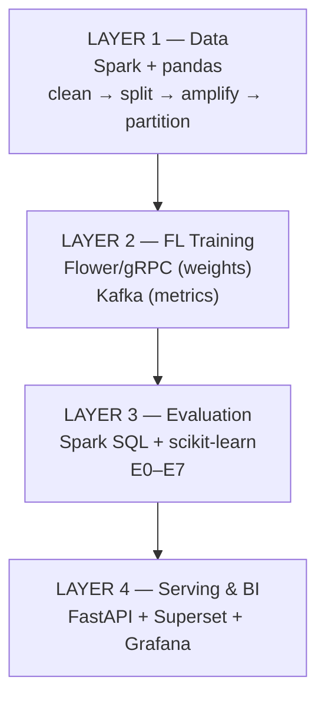
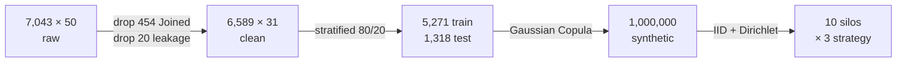
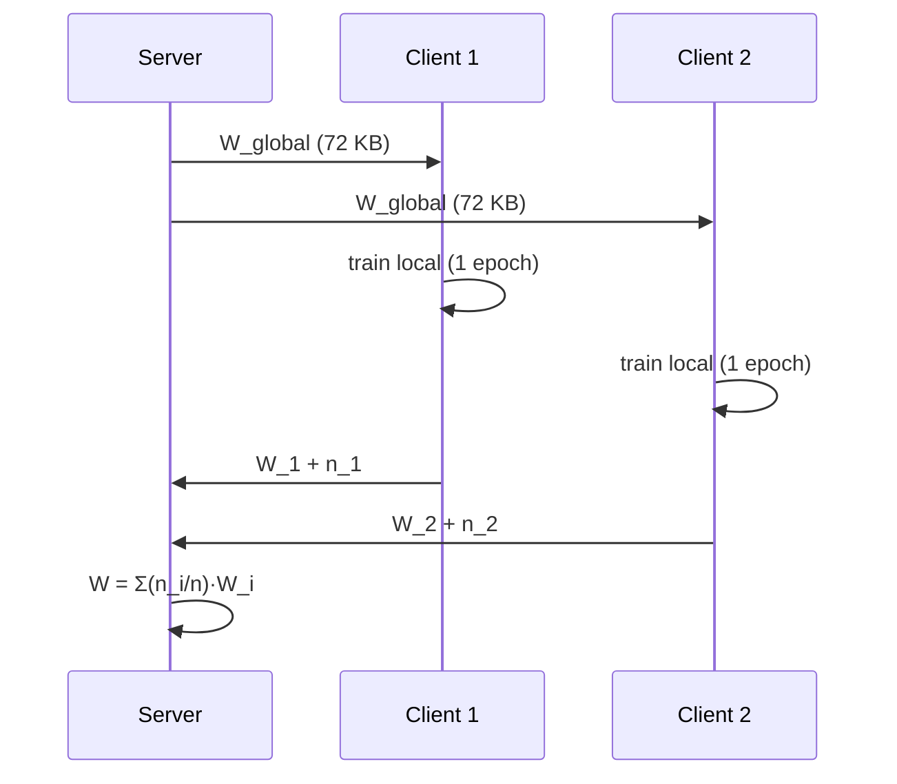
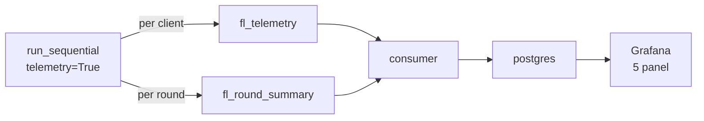

# 21 — Script thuyết trình 15 phút

> **Mục đích:** script nói đầy đủ, đọc thẳng được. Không phải bullet outline.
>
> **Phân bổ thời gian:** 15 phút nói + 5 phút Q&A.
>
> **Chuẩn bị trước khi nói:** mở sẵn 4 tab — Superset dashboard, Grafana live,
> FastAPI `/docs`, và `results/E1_fl_gap.csv`.

---

## Tổng quan thời gian

| # | Section | Thời gian | Slide |
|---|---|---|---|
| 1 | Mở đầu + vấn đề | 1:30 | 1–2 |
| 2 | Kiến trúc 4 layer | 2:30 | 3–5 |
| 3 | Data flow | 2:00 | 6–8 |
| 4 | Thực thi FL | 2:30 | 9–11 |
| 5 | Kết quả E0–E7 | 4:00 | 12–16 |
| 6 | Nhận định | 1:30 | 17 |
| 7 | Hướng cải thiện | 1:00 | 18 |
| | **Tổng** | **15:00** | |

---

## Section 1 — Mở đầu (1:30)

**[Slide 1: Tiêu đề]**

> "Chào thầy và các bạn. Đề tài của em là **Federated Learning cho bài toán dự
> đoán khách hàng rời bỏ dịch vụ viễn thông**. Điểm cốt lõi: dữ liệu khách hàng
> không bao giờ rời khỏi nơi nó được sinh ra."

**[Slide 2: Vấn đề]**

> "Bài toán có ba ràng buộc thực tế.
>
> **Một**, dữ liệu viễn thông bị chia cắt giữa nhiều đơn vị — chi nhánh, đối tác,
> hoặc vùng địa lý khác nhau. Không ai được phép gom tất cả về một chỗ, vì quy
> định bảo vệ dữ liệu cá nhân.
>
> **Hai**, dữ liệu churn rất mất cân bằng — chỉ 28% khách rời đi. Nếu model chỉ
> đoán 'không ai rời đi', nó đúng 72% nhưng vô dụng.
>
> **Ba**, dữ liệu thật chỉ có 6,589 dòng sau khi làm sạch. Quá ít để train một
> model đáng tin.
>
> Ba ràng buộc này định hình toàn bộ thiết kế: **federated learning** cho ràng
> buộc một, **synthetic data** cho ràng buộc ba, và **metric phù hợp** cho ràng
> buộc hai."

---

## Section 2 — Kiến trúc (2:30)

**[Slide 3: Sơ đồ 4 layer]**

> "Kiến trúc chia làm bốn layer, và mỗi layer có một ranh giới bất biến.

> "**Layer 1** chuẩn bị dữ liệu. Chạy song song hai implementation: pandas để dễ
> đọc và test, Spark để chứng minh scale được.
>
> **Layer 2** là federated training. Đây là layer quan trọng nhất về mặt nguyên
> tắc.
>
> **Layer 3** đánh giá. Mọi metric cuối cùng đều tính trên **dữ liệu thật**,
> không phải synthetic.
>
> **Layer 4** phục vụ: API dự đoán và dashboard."

**[Slide 4: Ba ranh giới bất biến]**

> "Ba ranh giới này không được vi phạm, và em kiểm tra chúng bằng test.

| Kênh | Chở gì | KHÔNG BAO GIỜ chở |
|---|---|---|
| **gRPC/Flower** | Model weights | Metrics, dữ liệu |
| **Kafka** | Metrics | Model weights, dữ liệu |
| **Spark** | Batch data + eval | Không bao giờ train model |

> "Nếu ai đề xuất dùng Kafka để truyền weights, đó là sai nguyên tắc cốt lõi —
> protocol không còn là federated learning chuẩn nữa. Và Spark không bao giờ nằm
> trong vòng lặp FL, vì FL cần cập nhật từng round, còn Spark là batch."

**[Slide 5: Vì sao GroupNorm]**

> "Một quyết định kỹ thuật nhỏ nhưng quan trọng: em dùng **GroupNorm** thay vì
> BatchNorm. Ba lý do, mỗi lý do đủ để quyết định:
>
> **Một**, Opacus — thư viện DP-SGD — không wrap được BatchNorm, vì per-sample
> gradient không xác định với BatchNorm.
>
> **Hai**, BatchNorm có buffer `running_mean` bị average qua các client có phân
> phối khác nhau. Ở đây client 5 có 0.87% churn, client 8 có 91.2% — average hai
> con số đó vô nghĩa.
>
> **Ba**, để so sánh công bằng E1–E7, kiến trúc phải giống nhau. Nếu E4 dùng
> kiến trúc khác vì Opacus, thì chênh lệch AUC không còn là do privacy."

---

## Section 3 — Data flow (2:00)

**[Slide 6: Pipeline]**

> "Dữ liệu đi qua năm bước, và mỗi bước có con số kiểm chứng.

> "Bắt đầu 7,043 dòng. Drop 454 dòng `Joined` — khách mới, chưa đủ thời gian để
> churn. Còn 6,589 dòng, churn rate **28.37%**.
>
> Drop 20 cột leakage. Đây là phần em dành nhiều thời gian nhất, vì leakage
> trong bài toán churn rất tinh vi. Ví dụ `Churn Score` — nó là dự đoán của IBM,
> không phải feature. `Satisfaction Score` — chỉ có sau khi khách đã bất mãn.
> `Total Revenue` — tính cả refunds, tức là biết trước tương lai.
>
> Còn 29 feature. Split **trước** khi amplify — điểm này quan trọng: nếu amplify
> trước rồi split, test set sẽ chứa dữ liệu tổng hợp và mọi metric mất ý nghĩa."

**[Slide 7: Synthetic quality]**

> "Amplify từ 5,271 lên 1 triệu dòng bằng **Gaussian Copula**. Em đánh giá qua
> sáu chiều:

| Chiều | Ngưỡng | Đo được |
|---|---|---|
| Marginal (KS/TVD) | ≥90% cột | **100%** (29/29) |
| Correlation | mean\|Δ\| < 0.10 | **0.0209** |
| Utility (TSTR gap) | < 0.05 | **0.0374** |
| Diversity | — | 100% unique |
| Memorization | — | 0.00% |
| Validity | 0 vi phạm | 0 |

> "TSTR gap 3.7% nghĩa là: train trên synthetic, test trên thật, AUC 0.8941 so
> với train trên thật 0.9315. Mất 3.7% — chấp nhận được.
>
> Một lỗi em đã sửa: lần đầu em train reference trên `test_real` rồi test trên
> chính nó → AUC 1.0000. Vô nghĩa. Phải train trên `train_real`."

**[Slide 8: Partition]**

> "Chia thành 10 silo theo ba cách:

| Strategy | Sizes | Churn range |
|---|---|---|
| IID | 90,000 × 10 | 0.282 – 0.287 |
| α=0.5 | 31K – 357K | 0.014 – 0.870 |
| α=0.1 | 16K – 531K | 0.009 – 0.912 |

> "α=0.1 là cực đoan nhất: một client giữ 59% dữ liệu, bốn client nhỏ nhất chỉ
> có 15,955 dòng. Đây là mức skew em cần để test E2 và E3.
>
> Lưu ý: bốn client nhỏ nhất đều đúng 15,955 dòng — vì em đặt floor 2% để không
> client nào nhận 0 dòng. Đánh đổi: skew thực tế nhẹ hơn raw Dirichlet draw."

---

## Section 4 — Thực thi FL (2:30)

**[Slide 9: Vòng lặp]**

> "Mỗi round gồm bốn bước:

> "Chỉ weights đi qua mạng. Không feature, không label, không gradient. Kèm theo
> là `num_examples` — một số nguyên — để server weight trung bình.
>
> Model có **18,049 tham số**, tức 72 KB mỗi chiều. Một round với 5 client tốn
> 0.72 MB."

**[Slide 10: Cấu hình]**

> "Cấu hình: 50 rounds, `fraction_fit=0.5` — chọn 5 trong 10 client mỗi round.
> Mỗi client train 1 epoch, batch 256, Adam lr=1e-3.
>
> Em implement **hai** runner: `run_sequential()` không cần Ray, và
> `run_simulation()` dùng Ray. Lý do: Flower 1.44 bắt buộc Ray cho
> `start_simulation`, mà Ray tốn 2–4 GB RAM và 10–20 giây khởi động. Với 50
> rounds × 10 client, sequential chỉ mất 6 phút — không đáng để thêm Ray."

**[Slide 11: Telemetry]**

> "Song song với training, mỗi round gửi metrics lên Kafka:

> "Điểm thiết kế: **fire-and-forget**. Nếu Kafka chết, training vẫn phải xong —
> telemetry là observability, không phải dependency. Ngược lại với gRPC: transport
> fail ở đó **phải** abort round, vì weights chính là training.
>
> Kết quả end-to-end: 60 message gửi, 0 lỗi, 50 client rows + 10 round rows vào
> postgres."

---

## Section 5 — Kết quả (4:00)

**[Slide 12: Bảng tổng hợp]**

> "Tám experiment, mỗi cái trả lời một câu hỏi:

| Exp | Câu hỏi | Kết quả | Verdict |
|---|---|---|---|
| E0 | IBM score mạnh cỡ nào? | AUC 0.9421 | Reference |
| E1 | FL có thua centralized? | gap **−0.30%** | ✅ |
| E2 | Non-IID có hại? | α=0.1 mất 0.67% | ✅ |
| E3 | FedProx/FedAvgM thắng? | −0.60% / −0.16% | ❌ |
| E4 | DP mất bao nhiêu? | σ=2 mất 0.94% | ✅ |
| E5 | FL công bằng? | std −10.3% | ✅ |
| E6 | FL scale được? | biến động 9.2% | ✅ |
| E7 | Communication khả thi? | 5× bw = 0.18% AUC | ✅ |

> "Mười trên mười một success criteria đạt. Cái không đạt là E3 — và đó là kết
> quả thật, em sẽ nói rõ ở phần sau."

**[Slide 13: E1 — FL gap]**

> "E1 là experiment quan trọng nhất: FL có thua centralized không?

| Model | AUC | Std |
|---|---|---|
| Centralized | 0.8954 | ±0.0020 |
| **Federated** | **0.8980** | ±0.0140 |
| Local-only | 0.8880 | ±0.0004 |

> "FL **thắng** centralized 0.30% trung bình. Nhưng nhìn std: FL biến động gấp
> **7 lần**. Vì mỗi round chọn 5/10 client khác nhau.
>
> FL thắng 2/5 fold, thua 3/5. CI chồng lấn ở mọi fold → khác biệt **không có ý
> nghĩa thống kê**. Kết luận trung thực: FL ngang centralized, không tệ hơn.
>
> Và FL hơn local-only 1.0 điểm — đây là giá trị thật của aggregation."

**[Slide 14: E2 + E3]**

> "E2 và E3 là cặp đôi: E2 hỏi non-IID có hại không, E3 hỏi có cách chống không.

| Partition | AUC | PR-AUC | Client std |
|---|---|---|---|
| IID | 0.8949 | 0.8121 | 0.0018 |
| α=0.5 | 0.8928 | 0.7985 | 0.0070 |
| α=0.1 | 0.8889 | 0.7876 | 0.0045 |

> "E2 PASS: cả ba chỉ số giảm đơn điệu. PR-AUC rơi mạnh nhất (−3.0%) vì nhạy với
> lớp thiểu số. Và per-client std tăng **3.9 lần** — đây mới là tác động rõ nhất:
> model kém đều hơn giữa các silo.
>
> E3 thì **FAIL**:

| Strategy | AUC | Client std | Hội tụ |
|---|---|---|---|
| FedAvg | **0.8889** | 0.0045 | 14 |
| FedProx | 0.8835 | 0.0040 | 30 |
| FedAvgM | 0.8875 | 0.0037 | 20 |

> "Không strategy nào cải thiện AUC. Nhưng cả hai đều **giảm client std** — tức
> là công bằng hơn dù không chính xác hơn.
>
> Vì sao FedProx không thắng? Vì mức skew không đủ cực đoan. Mỗi silo vẫn có
> ≥15,955 dòng. FedProx được thiết kế cho client có rất ít dữ liệu. Em không
> 'sửa' kết quả này bằng cách tăng α — đó là chọn dữ liệu để có kết quả mong muốn."

**[Slide 15: E4 + E5]**

> "E4 là privacy:

| σ | ε | AUC | Mất |
|---|---|---|---|
| 0 | ∞ | 0.8949 | — |
| 0.5 | 12.37 | 0.8941 | 0.09% |
| 1.0 | 1.55 | 0.8894 | 0.62% |
| 2.0 | **0.57** | 0.8865 | **0.94%** |

> "ε giảm từ vô cực xuống 0.57 mà chỉ mất 0.94% AUC. DP gần như miễn phí ở mức
> này. Nhưng PR-AUC mất 7.6% — lớp thiểu số bị ảnh hưởng rõ hơn.
>
> E5 là fairness. Em phải đổi metric giữa đường: `Churn Category` chỉ có ở người
> **đã churn**, nên mỗi stratum là 100% positive — AUC không xác định. Lần chạy
> đầu trả về `nan` đúng như dự đoán. Em đổi sang **recall theo lý do churn**.
>
> Kết quả: lý do `Price` khó nhất (recall 0.20 so với 0.36 ở `Competitor`). Khách
> rời vì giá có hành vi giống khách ở lại — họ không bất mãn dịch vụ."

**[Slide 16: E6 + E7]**

> "E6 và E7 là về chi phí.

| K | Clients/round | Tổng (s) |
|---|---|---|
| 5 | 2 | 354 |
| 10 | 5 | 381 |
| 20 | 10 | 371 |
| 50 | 25 | 387 |

> "Phát hiện bất ngờ: **chi phí phẳng, không tuyến tính**. K tăng 10 lần nhưng
> thời gian biến động chỉ 9.2%. Vì `fraction_fit` cố định — số client tăng nhưng
> mỗi silo nhỏ đi đúng tỉ lệ đó, nên tổng dữ liệu mỗi round luôn ~450K dòng.
>
> Cách đọc đúng: FL scale được về **số client** mà không scale về **thời gian**.
>
> E7: giảm từ 10 xuống 2 client/round — 5 lần ít băng thông — chỉ mất **0.18%**
> AUC. Với model 18K tham số, communication không phải nút thắt."

---

## Section 6 — Nhận định (1:30)

**[Slide 17: Ba nhận định]**

> "**Một: FL ngang centralized nhưng bất ổn hơn.** Gap −0.30% là tin tốt, nhưng
> std gấp 7 lần là cái giá thật. Trong production, cần nhiều round hơn hoặc
> client sampling thông minh hơn.
>
> **Hai: non-IID có hại nhưng nhẹ ở quy mô này.** 0.67% AUC là nhỏ, nhưng
> per-client std tăng 3.9 lần là tín hiệu nghiêm trọng hơn — model kém đều giữa
> các silo.
>
> **Ba: DP gần như miễn phí, communication không phải nút thắt.** Ở quy mô model
> 18K tham số, cả hai đều không phải vấn đề. Nhưng kết luận này **không** mở rộng
> được sang LLM — 72 MB cho 50 rounds sẽ thành hàng trăm GB."

---

## Section 7 — Hướng cải thiện (1:00)

**[Slide 18: Bốn hướng]**

> "**Một: thay Gaussian Copula bằng CTGAN hoặc TabDDPM.** Copula không bắt được
> tail dependence và non-linear interaction. TSTR gap 3.7% là do giới hạn này.
> Cần ≥10K dòng thật để CTGAN hoạt động tốt — hiện chỉ có 5,271.
>
> **Hai: thêm secure aggregation.** Hiện server thấy từng weight của từng client.
> Secure aggregation che luôn điều đó — client chỉ gửi tổng được mã hoá.
>
> **Ba: cá nhân hoá model (personalized FL).** FedProx thất bại vì nó kéo mọi
> client về một model chung. Hướng khác: mỗi client giữ một phần model riêng —
> FedBN, Ditto, hoặc Per-FedAvg.
>
> **Bốn: mở rộng sang vertical FL.** Hiện tại các silo có cùng feature set. Thực
> tế viễn thông hay có tình huống mỗi bên giữ một tập feature khác nhau — đó là
> vertical FL, bài toán khó hơn nhiều."

**[Slide 19: Kết]**

> "Tóm lại: em đã xây một pipeline FL hoàn chỉnh từ dữ liệu thô đến API và
> dashboard, với 8 experiment, 11 success criteria đạt 10, và 272 test.
>
> Điều em học được nhiều nhất không phải là thuật toán, mà là **kiểm chứng số
> liệu**. Ba lần trong project em tưởng mình biết nguyên nhân và cả ba lần đều
> sai — FedAvgM phân kỳ không phải do dấu momentum, E5.2 không dùng được AUC, và
> E1 không lưu curve. Mỗi lần, cách sửa đúng là chạy một script 5 dòng để kiểm
> chứng số học trước khi sửa code.
>
> Em xin hết. Cảm ơn thầy và các bạn."

---

## Phụ lục — Câu hỏi phản biện dự kiến

### Q1: "Tại sao E3 FAIL mà vẫn coi là thành công?"

> "E3 không phải tiêu chí bắt buộc — nó là 'nên có'. Và FAIL là kết quả thật:
> FedProx và FedAvgM đều không vượt FedAvg về AUC trên dữ liệu này. Em báo cáo
> trung thực thay vì chọn α cực đoan hơn để có kết quả đẹp. Điều đáng chú ý là
> cả hai đều **giảm per-client std** — công bằng hơn dù không chính xác hơn, đúng
> bản chất của chúng."

### Q2: "Synthetic data có đáng tin không?"

> "Sáu chiều đánh giá, tất cả PASS. Quan trọng nhất là TSTR: train trên synthetic,
> test trên **dữ liệu thật**, AUC 0.8941 so với 0.9315 khi train trên thật — mất
> 3.7%. Nếu synthetic vô dụng, gap sẽ lớn hơn nhiều. Nhưng em không nói synthetic
> thay được dữ liệu thật — nó chỉ giúp có đủ dữ liệu để train FL."

### Q3: "Vì sao không dùng BatchNorm?"

> "Ba lý do: Opacus không wrap được, buffer `running_mean` bị average qua client
> có phân phối khác nhau (0.87% vs 91.2% churn), và cần kiến trúc giống nhau để
> so sánh E1–E7 công bằng."

### Q4: "E6 nói chi phí phẳng — vậy FL không scale được?"

> "Ngược lại: FL scale được về **số client** mà không tăng thời gian. Cái giá là
> mỗi client có ít dữ liệu hơn mỗi round. Nếu muốn giữ nguyên dữ liệu/client,
> thời gian sẽ tăng tuyến tính — nhưng đó là lựa chọn về `fraction_fit`, không
> phải giới hạn của FL."

### Q5: "Sao không dùng Ray cho E6?"

> "Ray tốn 2–4 GB RAM và 10–20 giây khởi động. Với K=50, sequential mất 387 giây
> — chấp nhận được. Ray chỉ đáng khi K lớn hơn nhiều hoặc round phức tạp hơn.
> Em đã implement cả hai runner, chỉ chọn sequential cho experiment."

### Q6: "Privacy budget ε=0.57 có thực tế không?"

> "ε=0.57 với δ=1e-5 là mức khá chặt — nhiều ứng dụng production dùng ε trong
> khoảng 1–10. Nhưng ε phụ thuộc số bước: 50 rounds × 5 client × 352 batch =
> 17,600 bước. Nếu giảm rounds hoặc tăng batch size, ε sẽ thấp hơn nữa với cùng
> σ. Đây là đánh đổi giữa utility và privacy budget, không phải giới hạn cứng."

### Q7: "Vì sao E5.2 dùng recall mà không dùng AUC?"

> "`Churn Category` chỉ được điền cho khách **đã churn**. Nên mỗi stratum là
> 100% positive — không có lớp âm để xếp hạng, AUC không xác định về mặt toán
> học. Lần chạy đầu trả về `nan` đúng như vậy. Recall là metric đúng cho câu hỏi
> 'trong số khách rời vì lý do R, bao nhiêu % được gắn cờ'."

### Q8: "272 test — có test nào thật sự kiểm tra logic không?"

> "Có. Ví dụ: test FedAvgM kiểm tra `|r| = √β` bất kể learning rate — đây là
> tính chất toán học của nghiệm phương trình đặc trưng, không phải smoke test.
> Test `evaluate_recall_by_reason` kiểm tra ngưỡng top-10% tính **một lần trên
> toàn test set**, không per-stratum — nếu tính riêng, mỗi stratum luôn bị gắn cờ
> đúng 10% và che mất chênh lệch. Test Spark eval kiểm tra công thức
> Mann-Whitney bằng tay, không gọi MLlib."

---

## Checklist trước khi thuyết trình

- [ ] Superset mở sẵn: `http://localhost:8088` (admin/admin), 3 dashboard
- [ ] Grafana mở sẵn: `http://localhost:3000` (admin/admin), 5 panel
- [ ] FastAPI `/docs` mở sẵn: `http://localhost:8000/docs`
- [ ] `results/E1_fl_gap.csv` mở trong editor
- [ ] Slide có sẵn 6 mermaid diagram (render trước, không render live)
- [ ] Chuẩn bị sẵn câu trả lời cho 8 câu hỏi ở trên
- [ ] Đồng hồ bấm giờ: 15 phút
